# TP3 - Automatización y Scripting

**Universidad Nacional del Comahue - CURZA**
Tecnicatura Universitaria en Administración de Sistemas y Software Libre

- **Alumno:** Maxi Maidana
- **Legajo:** 9110
- **Token de Autenticidad:** 91109895

Cron, At, Systemd Timers y procesamiento de texto (grep, sed, awk).

## Estructura del repositorio

```
tp3-maidana-9110/
├── README.md
├── recursos/
│   ├── syslog_prueba.txt
│   └── capturas/
├── config/
│   ├── monitoreo_9110.service
│   └── monitoreo_9110.timer
├── codigo/
│   ├── monitorear_usuarios.sh
│   ├── descarga_programada.sh
│   ├── diagnostico_red.sh
│   ├── cambiar_hostname.sh
│   └── filtrar_errores.sh
└── logs/
    ├── usuarios_activos_9110.log
    ├── ping_report_9110.log
    └── reporte_errores_9110.txt
```

## Uso de cada script

| Script | Uso |
|---|---|
| `monitorear_usuarios.sh` | `./codigo/monitorear_usuarios.sh` registra fecha, hora y cantidad de usuarios activos en `logs/usuarios_activos_9110.log` |
| `descarga_programada.sh` | `./codigo/descarga_programada.sh <URL>` descarga el archivo a `descargas/` |
| `diagnostico_red.sh` | `./codigo/diagnostico_red.sh` hace ping al gateway y guarda el resultado en `logs/ping_report_9110.log` |
| `cambiar_hostname.sh` | `sudo ./codigo/cambiar_hostname.sh curzas-alumno-9110` modifica `/etc/hostname` y `/etc/hosts` |
| `filtrar_errores.sh` | `./codigo/filtrar_errores.sh [archivo]` genera `logs/reporte_errores_9110.txt` (por defecto usa `recursos/syslog_prueba.txt`) |

## Tarea 1: cron

Línea instalada en el crontab (cada 10 minutos, de lunes a viernes):

```
*/10 * * * 1-5 /home/max/Escritorio/tps-para-hacer/tp3-maidana-9110/codigo/monitorear_usuarios.sh
```

Crontab activo (`crontab -l`):


Log generado por cron:

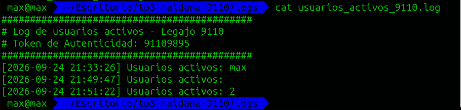

## Tarea 2: at

Descarga programada una única vez. Para la demostración se usó `now + 2 minutes`; para el enunciado el comando equivalente es `at 23:30 friday`.

```
echo "$(pwd)/codigo/descarga_programada.sh <URL>" | at now + 2 minutes
atq
```

Trabajo en cola (`atq`):

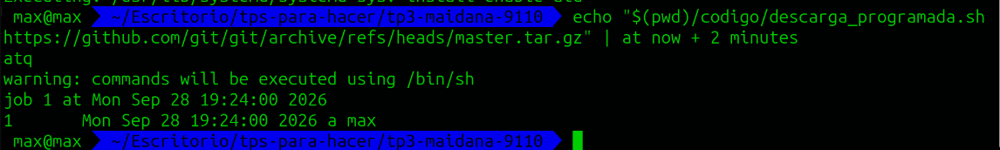

Archivo descargado y cola vacía tras la ejecución:

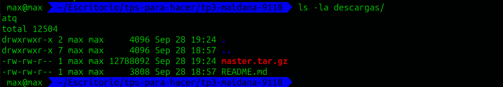

## Tarea 3: systemd timer

Comandos utilizados:

```
sudo systemctl link "$(pwd)/config/monitoreo_9110.service"
sudo systemctl link "$(pwd)/config/monitoreo_9110.timer"
sudo systemctl daemon-reload
sudo systemctl start monitoreo_9110.timer
sudo systemctl enable monitoreo_9110.timer
systemctl status monitoreo_9110.timer
systemctl list-timers
journalctl -u monitoreo_9110.service -f
```

Registro, inicio y habilitación:

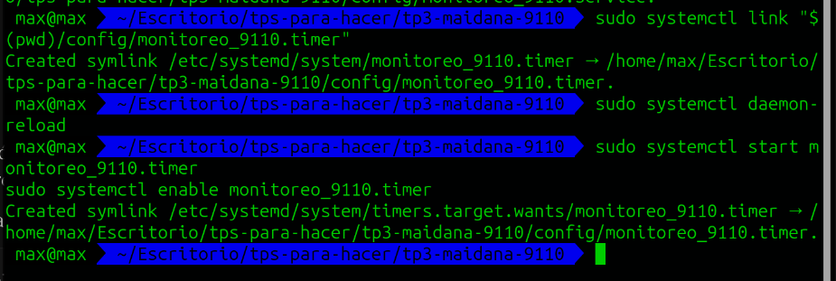

Estado del timer:

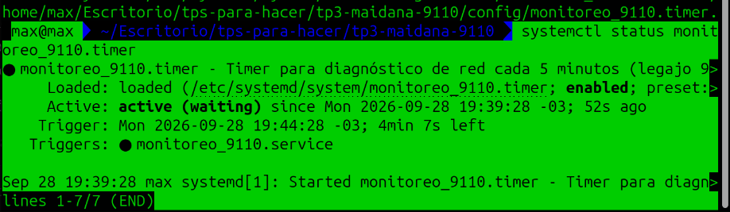

Listado de timers:

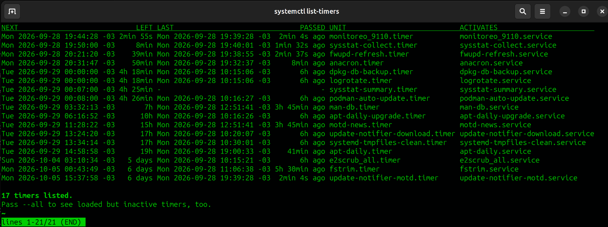

Logs del servicio:

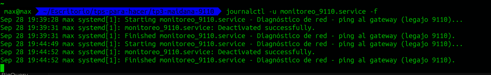

Log de ping generado:

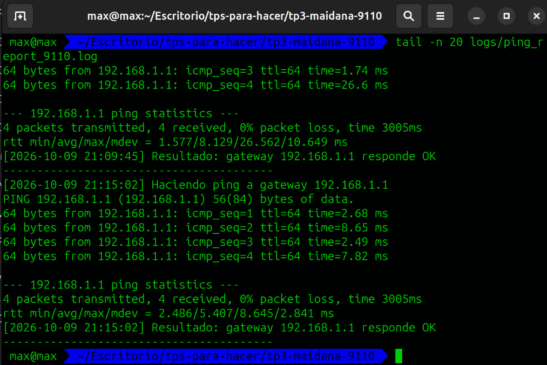

## Tarea 4: cambio de hostname

Sin privilegios de administrador el script falla (prueba sobre copias en `/tmp`):

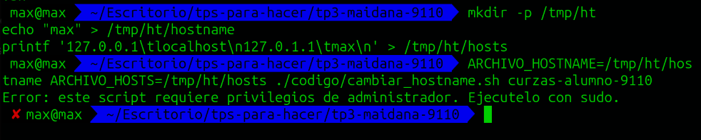

Ejecución exitosa con `sudo` y archivos resultantes:

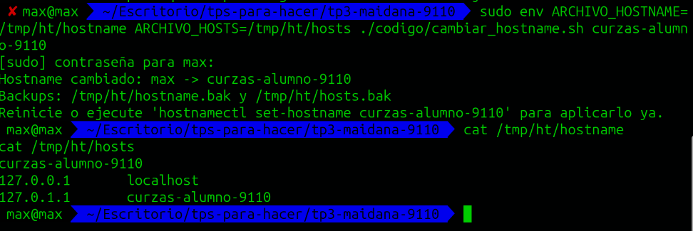

## Tarea 5: procesamiento de syslog con awk

Reporte generado a partir de `recursos/syslog_prueba.txt`:

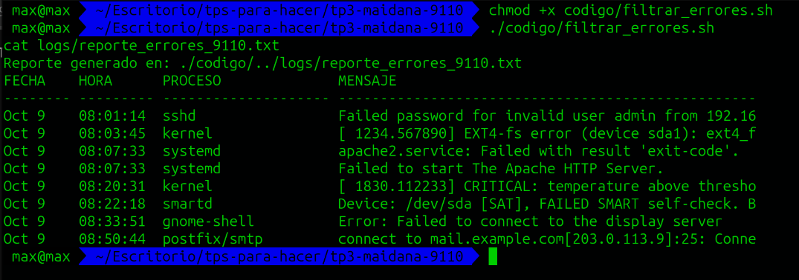

## Notas

- Todas las rutas en cron y systemd son absolutas.
- El cambio de hostname se probó sobre copias en `/tmp` para no alterar el sistema real.
- La carpeta `descargas/` no se versiona (`.gitignore`) por el tamaño del archivo descargado.
